

<picture><source media="(prefers-color-scheme: dark)" srcset="assets/hero-dark-b7f04f78.svg"></picture> 
<a href="https://github.com/folzy1092"><picture><source media="(prefers-color-scheme: dark)" srcset="assets/link-github-dark-1c79b4c8.svg"></picture></a><a href="https://folzy.ru"><picture><source media="(prefers-color-scheme: dark)" srcset="assets/link-site-dark-5dc1e98b.svg"></picture></a><a href="https://folzy.is-a.dev"><picture><source media="(prefers-color-scheme: dark)" srcset="assets/link-dev-dark-2b1ca882.svg"></picture></a><a href="https://t.me/folzybio"><picture><source media="(prefers-color-scheme: dark)" srcset="assets/link-channel-dark-4232cf9e.svg"></picture></a> 
<picture><source media="(prefers-color-scheme: dark)" srcset="assets/about-dark-319b0078.svg"></picture> 
<picture><source media="(prefers-color-scheme: dark)" srcset="assets/section-projects-dark-63907eca.svg"></picture> 
<a href="https://github.com/folzy1092/Shadow"><picture><source media="(prefers-color-scheme: dark)" srcset="assets/project-shadow-dark-1a5f18da.svg"></picture></a> 
<a href="https://github.com/folzy1092/Yandex-Game/tree/main/DroneStrike"><picture><source media="(prefers-color-scheme: dark)" srcset="assets/project-dronestrike-dark-c04ecad6.svg"></picture></a><a href="https://github.com/folzy1092/gazon"><picture><source media="(prefers-color-scheme: dark)" srcset="assets/project-gazon-dark-81223500.svg"></picture></a> 
<a href="https://github.com/folzy1092/SoundCloud-Shuffle"><picture><source media="(prefers-color-scheme: dark)" srcset="assets/project-soundcloud-shuffle-dark-08225030.svg"></picture></a><a href="https://github.com/folzy1092/Web-Converter"><picture><source media="(prefers-color-scheme: dark)" srcset="assets/project-web-converter-dark-288b87e8.svg"></picture></a> 
<picture><source media="(prefers-color-scheme: dark)" srcset="assets/section-bots-dark-4baf3f10.svg"></picture> 
<a href="https://t.me/folzymanagebot"><picture><source media="(prefers-color-scheme: dark)" srcset="assets/project-selfbot-dark-911c1f42.svg"></picture></a><a href="https://t.me/lgucheckbot"><picture><source media="(prefers-color-scheme: dark)" srcset="assets/project-lengubot-dark-dbbc0c9a.svg"></picture></a><a href="https://github.com/folzy1092/phototoemoji"><picture><source media="(prefers-color-scheme: dark)" srcset="assets/project-phototoemoji-dark-c75f043e.svg"></picture></a> 
<a href="https://github.com/folzy1092?tab=repositories"><picture><source media="(prefers-color-scheme: dark)" srcset="assets/footer-dark-8cd9ff22.svg"></picture></a>

