<picture><source media="(prefers-color-scheme: dark)" srcset="assets/hero-dark-7aaee6ef.svg"></picture> 
<a href="https://github.com/folzy1092"><picture><source media="(prefers-color-scheme: dark)" srcset="assets/link-github-dark-7bde0cba.svg"></picture></a><a href="https://folzy.ru"><picture><source media="(prefers-color-scheme: dark)" srcset="assets/link-site-dark-5e340189.svg"></picture></a><a href="https://folzy.is-a.dev"><picture><source media="(prefers-color-scheme: dark)" srcset="assets/link-dev-dark-31f678d2.svg"></picture></a><a href="https://t.me/folzybio"><picture><source media="(prefers-color-scheme: dark)" srcset="assets/link-channel-dark-16471deb.svg"></picture></a> 
<picture><source media="(prefers-color-scheme: dark)" srcset="assets/about-dark-3e256438.svg"></picture> 
<picture><source media="(prefers-color-scheme: dark)" srcset="assets/section-projects-dark-191de33d.svg"></picture> 
<a href="https://github.com/folzy1092/Shadow"><picture><source media="(prefers-color-scheme: dark)" srcset="assets/project-shadow-dark-87888cdf.svg"></picture></a> 
<a href="https://github.com/folzy1092/Yandex-Game/tree/main/DroneStrike"><picture><source media="(prefers-color-scheme: dark)" srcset="assets/project-dronestrike-dark-823da8fa.svg"></picture></a><a href="https://github.com/folzy1092/gazon"><picture><source media="(prefers-color-scheme: dark)" srcset="assets/project-gazon-dark-71744a56.svg"></picture></a> 
<a href="https://github.com/folzy1092/SoundCloud-Shuffle"><picture><source media="(prefers-color-scheme: dark)" srcset="assets/project-soundcloud-shuffle-dark-d8595c34.svg"></picture></a><a href="https://github.com/folzy1092/Web-Converter"><picture><source media="(prefers-color-scheme: dark)" srcset="assets/project-web-converter-dark-67f665c4.svg"></picture></a> 
<picture><source media="(prefers-color-scheme: dark)" srcset="assets/section-bots-dark-79395ff5.svg"></picture> 
<a href="https://t.me/folzymanagebot"><picture><source media="(prefers-color-scheme: dark)" srcset="assets/project-selfbot-dark-19eb1822.svg"></picture></a><a href="https://t.me/lgucheckbot"><picture><source media="(prefers-color-scheme: dark)" srcset="assets/project-lengubot-dark-7d4e6978.svg"></picture></a><a href="https://github.com/folzy1092/phototoemoji"><picture><source media="(prefers-color-scheme: dark)" srcset="assets/project-phototoemoji-dark-4c6c509d.svg"></picture></a> 
<a href="https://github.com/folzy1092?tab=repositories"><picture><source media="(prefers-color-scheme: dark)" srcset="assets/footer-dark-a271a36c.svg"></picture></a>

