

<picture><source media="(prefers-color-scheme: dark)" srcset="assets/hero-dark.svg"></picture>

<a href="https://github.com/folzy1092"><picture><source media="(prefers-color-scheme: dark)" srcset="assets/link-github-dark.svg"></picture></a>&nbsp;<a href="https://folzy.ru"><picture><source media="(prefers-color-scheme: dark)" srcset="assets/link-site-dark.svg"></picture></a>&nbsp;<a href="https://folzy.is-a.dev"><picture><source media="(prefers-color-scheme: dark)" srcset="assets/link-dev-dark.svg"></picture></a>&nbsp;<a href="https://t.me/folzybio"><picture><source media="(prefers-color-scheme: dark)" srcset="assets/link-channel-dark.svg"></picture></a>

<picture><source media="(prefers-color-scheme: dark)" srcset="assets/about-dark.svg"></picture>

<a href="https://github.com/folzy1092/Shadow"><picture><source media="(prefers-color-scheme: dark)" srcset="assets/project-shadow-dark.svg"></picture></a>&nbsp;<a href="https://t.me/folzymanagebot"><picture><source media="(prefers-color-scheme: dark)" srcset="assets/project-selfbot-dark.svg"></picture></a> <a href="https://t.me/lgucheckbot"><picture><source media="(prefers-color-scheme: dark)" srcset="assets/project-lengubot-dark.svg"></picture></a>&nbsp;<a href="https://github.com/folzy1092/phototoemoji"><picture><source media="(prefers-color-scheme: dark)" srcset="assets/project-phototoemoji-dark.svg"></picture></a> <a href="https://github.com/folzy1092/Yandex-Game/tree/main/DroneStrike"><picture><source media="(prefers-color-scheme: dark)" srcset="assets/project-dronestrike-dark.svg"></picture></a>&nbsp;<a href="https://github.com/folzy1092/gazon"><picture><source media="(prefers-color-scheme: dark)" srcset="assets/project-gazon-dark.svg"></picture></a> <a href="https://github.com/folzy1092/SoundCloud-Shuffle"><picture><source media="(prefers-color-scheme: dark)" srcset="assets/project-soundcloud-shuffle-dark.svg"></picture></a>&nbsp;<a href="https://github.com/folzy1092/Web-Converter"><picture><source media="(prefers-color-scheme: dark)" srcset="assets/project-web-converter-dark.svg"></picture></a>

<a href="https://github.com/folzy1092?tab=repositories"><picture><source media="(prefers-color-scheme: dark)" srcset="assets/footer-dark.svg"></picture></a>

