

<picture><source media="(prefers-color-scheme: dark)" srcset="assets/hero-dark-43db3554.svg"></picture> 
<a href="https://github.com/folzy1092"><picture><source media="(prefers-color-scheme: dark)" srcset="assets/link-github-dark-586065f6.svg"></picture></a><a href="https://folzy.ru"><picture><source media="(prefers-color-scheme: dark)" srcset="assets/link-site-dark-dce235fc.svg"></picture></a><a href="https://folzy.is-a.dev"><picture><source media="(prefers-color-scheme: dark)" srcset="assets/link-dev-dark-09f3db09.svg"></picture></a><a href="https://t.me/folzybio"><picture><source media="(prefers-color-scheme: dark)" srcset="assets/link-channel-dark-2cfe36f1.svg"></picture></a> 
<picture><source media="(prefers-color-scheme: dark)" srcset="assets/about-dark-17deaade.svg"></picture> 
<picture><source media="(prefers-color-scheme: dark)" srcset="assets/section-projects-dark-aa4c58cc.svg"></picture> 
<a href="https://github.com/folzy1092/Shadow"><picture><source media="(prefers-color-scheme: dark)" srcset="assets/project-shadow-dark-ad941c8c.svg"></picture></a> 
<a href="https://github.com/folzy1092/Yandex-Game/tree/main/DroneStrike"><picture><source media="(prefers-color-scheme: dark)" srcset="assets/project-dronestrike-dark-03164ffc.svg"></picture></a><a href="https://github.com/folzy1092/gazon"><picture><source media="(prefers-color-scheme: dark)" srcset="assets/project-gazon-dark-2c8437a7.svg"></picture></a> 
<a href="https://github.com/folzy1092/SoundCloud-Shuffle"><picture><source media="(prefers-color-scheme: dark)" srcset="assets/project-soundcloud-shuffle-dark-40e8685f.svg"></picture></a><a href="https://github.com/folzy1092/Web-Converter"><picture><source media="(prefers-color-scheme: dark)" srcset="assets/project-web-converter-dark-fc0698ae.svg"></picture></a> 
<picture><source media="(prefers-color-scheme: dark)" srcset="assets/section-bots-dark-36b7dc70.svg"></picture> 
<a href="https://t.me/folzymanagebot"><picture><source media="(prefers-color-scheme: dark)" srcset="assets/project-selfbot-dark-cad07147.svg"></picture></a><a href="https://t.me/lgucheckbot"><picture><source media="(prefers-color-scheme: dark)" srcset="assets/project-lengubot-dark-2570d9a2.svg"></picture></a><a href="https://github.com/folzy1092/phototoemoji"><picture><source media="(prefers-color-scheme: dark)" srcset="assets/project-phototoemoji-dark-2c14e40d.svg"></picture></a> 
<a href="https://github.com/folzy1092?tab=repositories"><picture><source media="(prefers-color-scheme: dark)" srcset="assets/footer-dark-fdb48cfa.svg"></picture></a>

