

<picture><source media="(prefers-color-scheme: dark)" srcset="assets/hero-dark-67f205f5.svg"></picture> 
<a href="https://github.com/folzy1092"><picture><source media="(prefers-color-scheme: dark)" srcset="assets/link-github-dark-869186d4.svg"></picture></a><a href="https://folzy.ru"><picture><source media="(prefers-color-scheme: dark)" srcset="assets/link-site-dark-d2ce4a26.svg"></picture></a><a href="https://folzy.is-a.dev"><picture><source media="(prefers-color-scheme: dark)" srcset="assets/link-dev-dark-39ebc053.svg"></picture></a><a href="https://t.me/folzybio"><picture><source media="(prefers-color-scheme: dark)" srcset="assets/link-channel-dark-9c8c83ee.svg"></picture></a> 
<picture><source media="(prefers-color-scheme: dark)" srcset="assets/about-dark-6de8fd5d.svg"></picture> 
<picture><source media="(prefers-color-scheme: dark)" srcset="assets/section-projects-dark-e0aa2f77.svg"></picture> 
<a href="https://github.com/folzy1092/Shadow"><picture><source media="(prefers-color-scheme: dark)" srcset="assets/project-shadow-dark-fabfa905.svg"></picture></a> 
<a href="https://github.com/folzy1092/Yandex-Game/tree/main/DroneStrike"><picture><source media="(prefers-color-scheme: dark)" srcset="assets/project-dronestrike-dark-f55f7591.svg"></picture></a><a href="https://github.com/folzy1092/gazon"><picture><source media="(prefers-color-scheme: dark)" srcset="assets/project-gazon-dark-2d9a85d3.svg"></picture></a> 
<a href="https://github.com/folzy1092/SoundCloud-Shuffle"><picture><source media="(prefers-color-scheme: dark)" srcset="assets/project-soundcloud-shuffle-dark-ed0bc3ab.svg"></picture></a><a href="https://github.com/folzy1092/Web-Converter"><picture><source media="(prefers-color-scheme: dark)" srcset="assets/project-web-converter-dark-1a740419.svg"></picture></a> 
<picture><source media="(prefers-color-scheme: dark)" srcset="assets/section-bots-dark-aa2ede6a.svg"></picture> 
<a href="https://t.me/folzymanagebot"><picture><source media="(prefers-color-scheme: dark)" srcset="assets/project-selfbot-dark-2a5a4000.svg"></picture></a><a href="https://t.me/lgucheckbot"><picture><source media="(prefers-color-scheme: dark)" srcset="assets/project-lengubot-dark-1550c007.svg"></picture></a><a href="https://github.com/folzy1092/phototoemoji"><picture><source media="(prefers-color-scheme: dark)" srcset="assets/project-phototoemoji-dark-e9311c53.svg"></picture></a> 
<a href="https://github.com/folzy1092?tab=repositories"><picture><source media="(prefers-color-scheme: dark)" srcset="assets/footer-dark-9049c2e0.svg"></picture></a>

